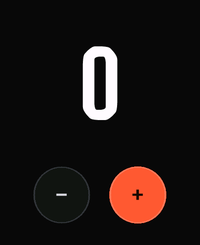

# 04 — Build and flash the composed target

There are four separate concepts:

| Concept | Where it lives | What it controls |
| --- | --- | --- |
| Chip driver | `@geastack/chips` | Reusable logic for one controller, independent of a board |
| Base target | `@geastack/targets` | Tested ESP-IDF, display, runtime, partition, build and flash integration |
| Custom target | your app's `.gea/targets/*.json` | The base to extend, exact driver selection, buses, and GPIO pins |
| Board alias | your app's `.gea/boards.json` | A short local name that selects the custom target and stores connection details |

This tutorial's custom target combines these hardware pieces:

| Role | Selection |
| --- | --- |
| MCU and radios | ESP32-S3 with built-in Wi-Fi and BLE |
| Display | CO5300, 410×502, QSPI |
| Touch | FT3168 over I²C |
| Power | AXP2101 |
| Motion | QMI8658 |
| Audio | ES8311 over I²S |

This snapshot contains the target produced in the previous step. Its `extends`
field selects the generic ESP32-S3 platform. The `chips` object selects the
driver for each hardware role, while `buses`, `storage`, and `controls`
describe the physical wiring.

During CMake configuration, `@geastack/targets` validates this file, turns the
chip names into the exact source list, and generates `board.h` in the project's
`.gea/build/manual-amoled/` output. Changing a pin in this JSON therefore
changes the C++ firmware configuration. Naming an unsupported chip stops the
build and reports the unsupported field.

The [`.gea/boards.json`](./.gea/boards.json) file connects that definition to
the local alias `manual-amoled`. The alias comes from step 03 (the wizard also
writes `"adapter": "esp32-idf"`, which the target definition already
declares); the `transports.ota.host` entry is added at the end of this step,
once the board is on Wi-Fi:

```json
{
  "manual-amoled": {
    "target": "manual-amoled",
    "targetDefinition": "targets/manual-amoled.json",
    "appPlatform": "esp32",
    "transports": {
      "ota": {
        "host": "192.168.1.100"
      }
    }
  }
}
```

The definition path is relative to `.gea/boards.json`. Connection details such
as the board's USB serial number or OTA host are stored under the alias with
`gea boards set`.

## Update the app for the board

The app from step 01 now gets Wi-Fi, a layout sized for this panel and its own
fonts.

Copy the [`src/fonts`](./src/fonts) folder from this step into your project's
`src/`. It holds `Inter-Regular.ttf` and `BebasNeue-Regular.ttf`; firmware
bakes text from the TTF files a stylesheet names with `@font-face`.

Replace `src/index.tsx`. `Display.setFlushConfig` reserves internal DMA memory
for the ESP32 Wi-Fi driver, and the Wi-Fi credentials come from `.env`:

```tsx
import { Display, WiFi, mount } from '@geastack/core'
import { App } from './App'

// Reserve internal DMA memory for the ESP32 Wi-Fi driver, then connect with
// credentials supplied through the ignored local .env file.
Display.setFlushConfig({ rows: 36, depth: 2 })
const ssid = import.meta.env.GEA_WIFI_SSID
const password = import.meta.env.GEA_WIFI_PASSWORD
if (ssid.length > 0) WiFi.configure(ssid, password)

mount(App)
```

In `src/App.tsx`, replace the eyebrow, title and count lines with a readout:

```tsx
        <div class="readout">
          <span class="count">{this.count}</span>
          <div class="accent" />
        </div>
```

Replace `src/styles.css` with [this step's stylesheet](./src/styles.css). It
declares both fonts, sets the count in Bebas Neue at 140px with a short accent
bar under it (`.readout`, `.accent`) and draws round buttons, laid out for the panel's 273×334 CSS viewport (410×502 physical pixels
at a 1.5 device pixel ratio).

Create `.env` in the project root with your Wi-Fi network:

```sh
GEA_WIFI_SSID=Your Wi-Fi name
GEA_WIFI_PASSWORD=Your Wi-Fi password
```

`.env` is listed in `.gitignore`, and this step's folder ships the same two
lines as [`.env.example`](./.env.example). Add `build` and `flash` scripts that
go through the alias:

```sh
npm pkg set scripts.build="gea build --board manual-amoled" scripts.flash="gea flash --board manual-amoled"
```

## Build and flash

Build through the alias. Configuration validates every chip binding and GPIO,
then CMake compiles only the chosen native drivers:

```sh
npm run check
npm run build
```

The values in `.env` are inlined into the local firmware image and never
committed.

For the first USB flash, plug the board in and let the CLI identify it:

```sh
npx gea boards discover
```

Each line names a serial device, the alias it belongs to (`not configured`
for now) and the USB serial number when the device publishes one. Record the
serial under the alias so the CLI finds the board on whatever port it lands
on, then flash:

```sh
npx gea boards set manual-amoled serial <usb-serial>
npx gea flash --board manual-amoled --monitor
```

The ESP32-S3's built-in USB Serial/JTAG publishes no serial number. If
`discover` shows none, pass the serial device it printed instead:
`npx gea flash --board manual-amoled --port <serial-device> --monitor`.

Because the app manifest enables BLE, this first flash also installs the BLE
OTA service for later wireless application updates.

Capture the framebuffer through the same board alias:

```sh
npx gea screenshot counter.png --board manual-amoled
```

The command writes a PNG at the path you provide, so you can inspect the exact
pixels rendered by the board without a camera. Stop the serial monitor first;
it keeps the USB port busy.



After this first USB installation, use BLE OTA for application updates:

```sh
npx gea ota --board manual-amoled --transport ble
```

The installed firmware also joins your Wi-Fi network and starts its HTTP OTA
server. Store the address the serial monitor prints as the board's OTA host,
and Wi-Fi becomes the fast path for subsequent updates:

```sh
npx gea boards set manual-amoled host 192.168.1.100
npx gea ota --board manual-amoled --transport wifi
```

For a one-off address, `--host <ip>` overrides the stored one. With the host
stored, `npx gea screenshot` and `npx gea logs` also work over Wi-Fi with no
cable.

`npx gea chips list` shows every chip in the installed catalog with its
binding, `esp32-idf` or `unbound`. `@geastack/chips` 0.1.8 has ESP32 bindings
for the CO5300, SH8601 and parallel RGB displays; FT3168 and GT911 touch;
AXP2101 power; QMI8658 motion; ES8311 and NS4168 audio; the BM8563 clock; and
the CH422G, TCA9554 and PCA9557 expanders plus Elecrow board controllers. A
controller without an ESP32 binding remains visible in `gea chips list`, but
composition rejects it before starting a native build.
